# Buddy

A small animated face on the dongle, with moods, short lines and chirps. It
blinks and glances around on its own, cheers a typing streak, sulks when a
half drops out and nods along to music. A brain on the PC or the phone can
drive it with an emotion and a line - from Gemini, or canned - and with no
brain at all it runs on moods of its own.

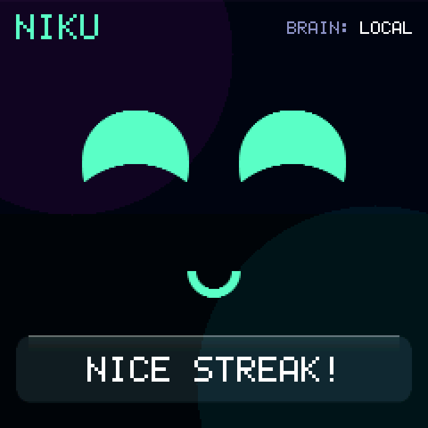

Off by default, and off adds nothing to the build.

## Turning it on

In your config's `nexus_dongle.conf`:

```
CONFIG_NEXUS_BUDDY=y
CONFIG_NEXUS_BUDDY_OWNER="VAIBHAV"
# Optional: Buddy asleep instead of a blank screen, with a computer on USB.
# CONFIG_NEXUS_BUDDY_IDLE_FACE=y
```

Then **Settings > BUDDY > SHOW**, or bind a key:

```c
&nexus_action NEXUS_ACT_BUDDY     /* opens the face; again closes it */
```

On the face, a **tap** pokes it (a giggle and a line) and a **hold** goes back.

| Option | Default | |
| --- | --- | --- |
| `CONFIG_NEXUS_BUDDY_NAME` | `"NIKU"` | The name above the face. |
| `CONFIG_NEXUS_BUDDY_OWNER` | `""` | Your name, for a greeting and the odd line. |
| `CONFIG_NEXUS_BUDDY_IDLE_FACE` | `n` | Sleep on screen instead of blanking, with a computer on USB. |
| `CONFIG_NEXUS_BUDDY_PHONE` | `y` | NEXUS Remote may be the brain. |
| `CONFIG_NEXUS_BUDDY_LEASE_S` | `60` | How long a silent brain keeps the face. |
| `CONFIG_NEXUS_BUDDY_QUIET_START` / `_END` | `23` / `8` | No sounds in these hours. |

[configuration.md](configuration.md#buddy) has the details.

## Settings > BUDDY

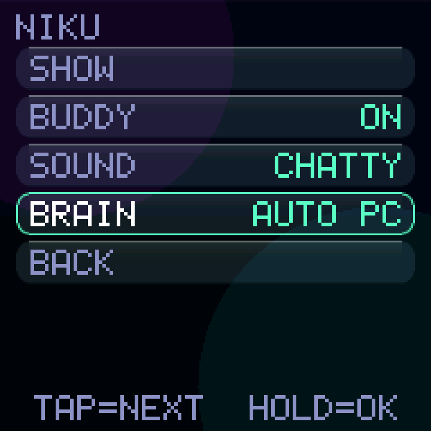

| Row | |
| --- | --- |
| `SHOW` | Open the face. |
| `BUDDY` | `ON`, or `OFF`: asleep, silent, ignoring every brain. |
| `SOUND` | `OFF`, `CHIRPS` (a cue per emotion, at most one unprompted every three minutes) or `CHATTY` (and a typing blip per letter as a line appears; the default). |
| `BRAIN` | Who may drive the face: `AUTO` (whoever spoke last - the row also shows who that is), `PC`, `PHONE`, or `LOCAL` (nobody; its own moods only). |

They are saved with SAVE like everything else, under their own key.

## The faces

Fifteen of them, each a row of numbers in `src/buddy/face_anim.c` and drawn
from geometry - no sprites. The last six hold a drawn prop for the tricks:
a microphone with notes, a waving hand, both hands up, a thumbs-up, a
gamepad, and a screen cracked from a hit. Every colour is a theme slot, so they read on
every palette, DAYLIGHT's light ground included. A slot too close to the
background (AMOLED and CLAY have no glow colour, which sad and listening
use) is drawn in the theme's text colour instead.

| | | |
| --- | --- | --- |
| 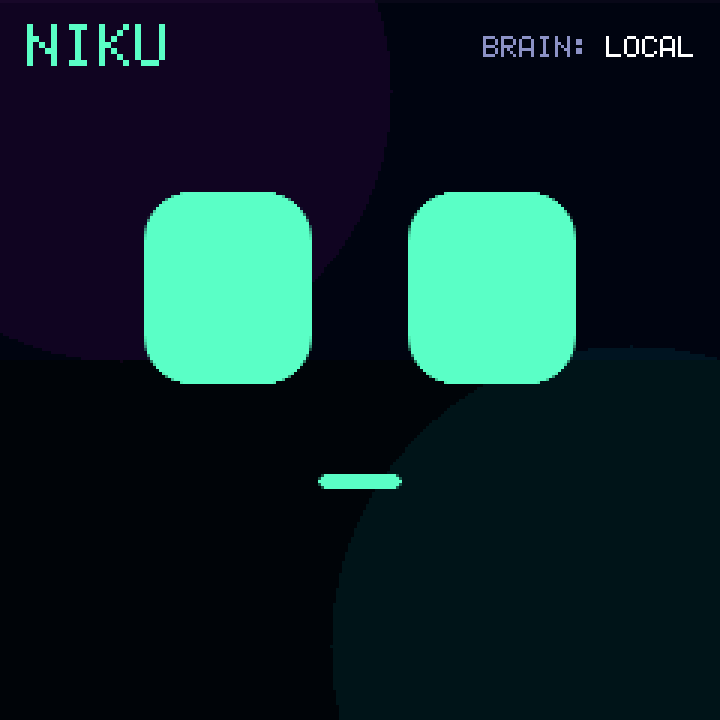 |  | 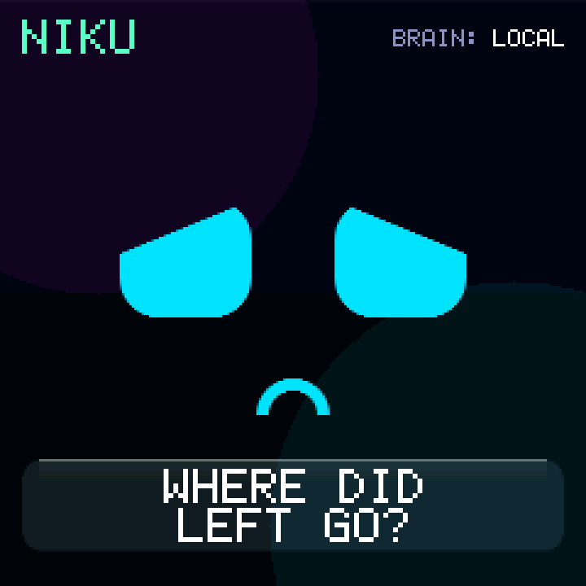 |
| neutral | happy | sad |
| 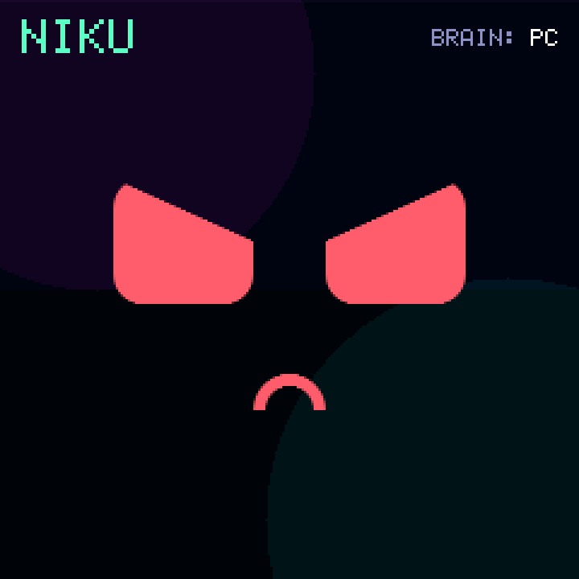 | 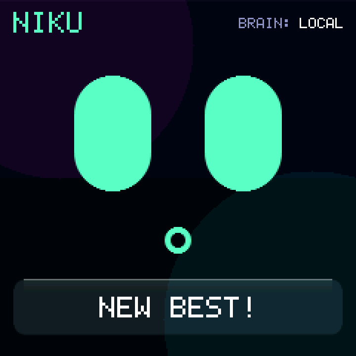 | 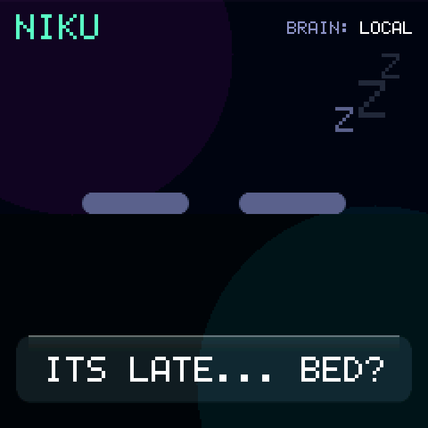 |
| angry | surprised | sleepy |
| 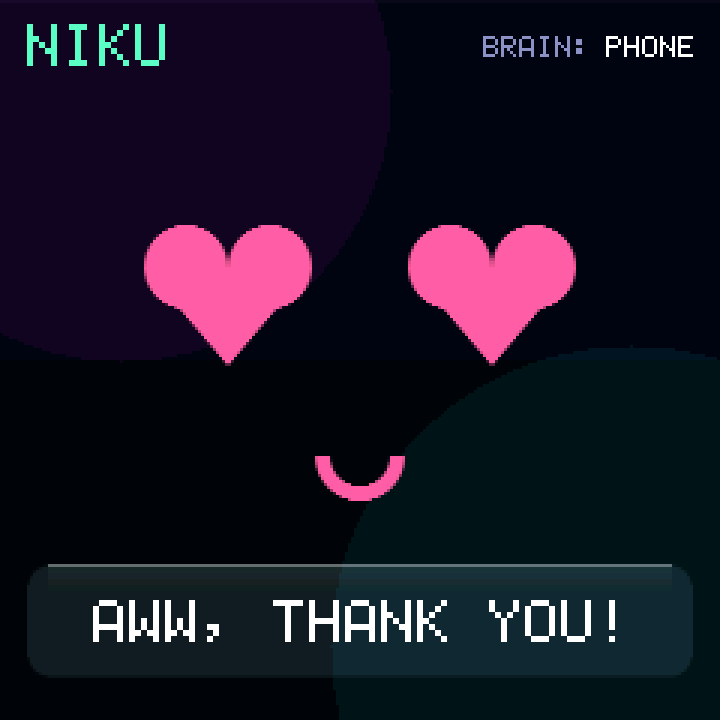 | 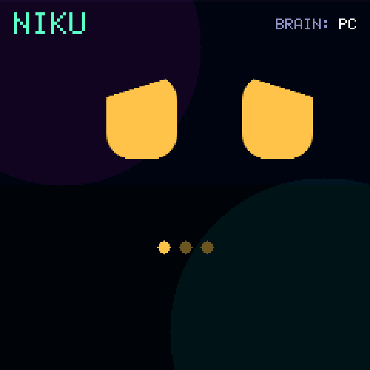 | 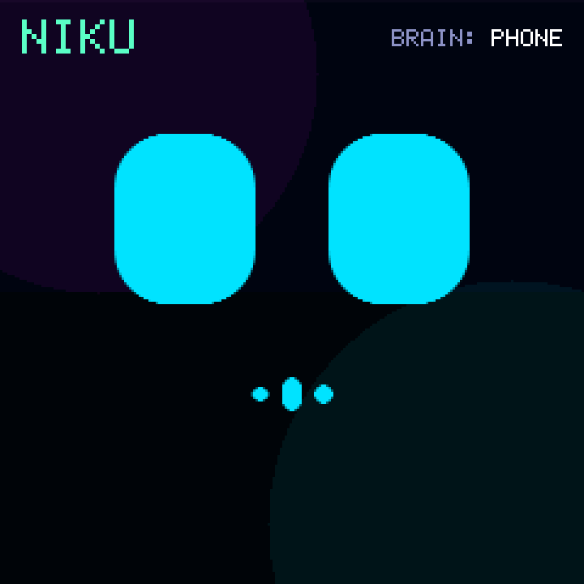 |
| love | thinking | listening |
| 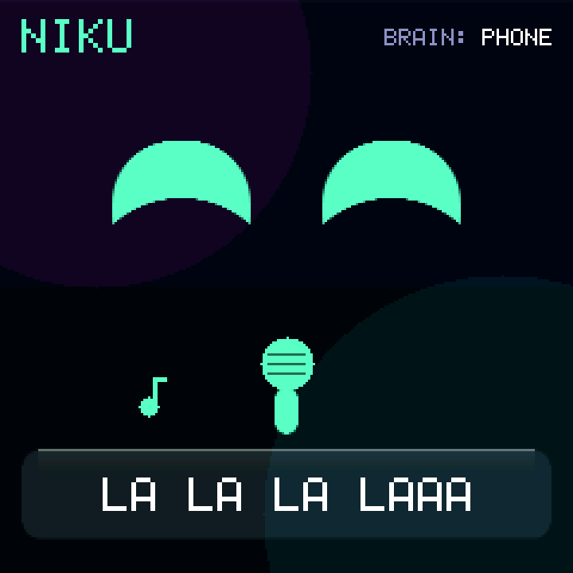 |  | 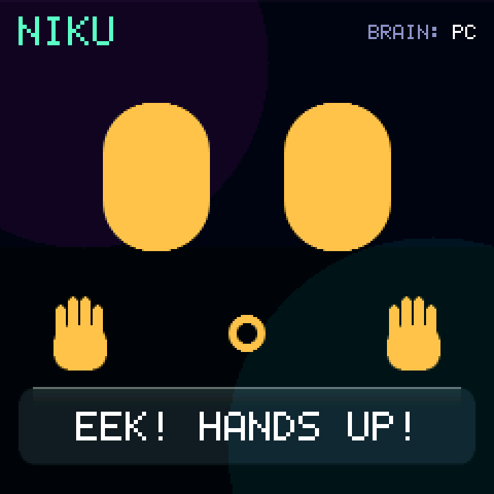 |
| singing | highfive | handsup |
| 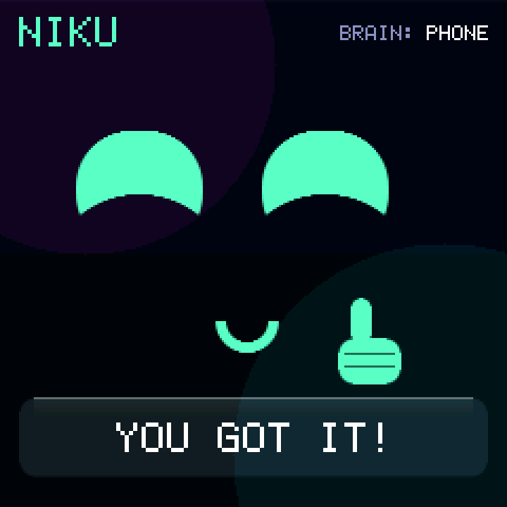 | 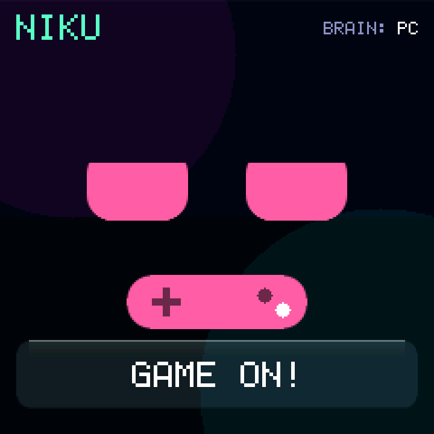 | 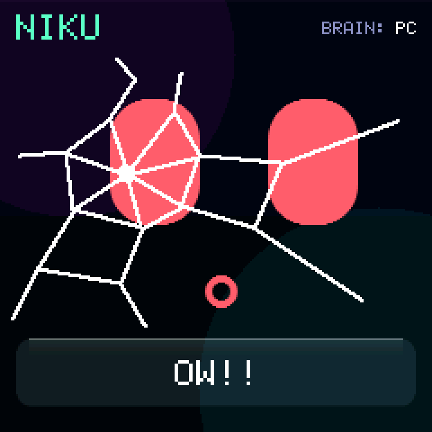 |
| thumbsup | gaming | bang |

| 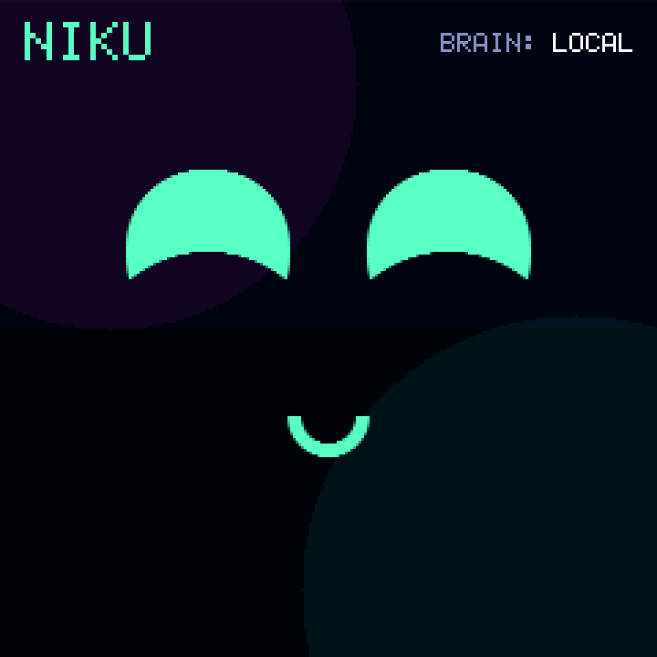 | 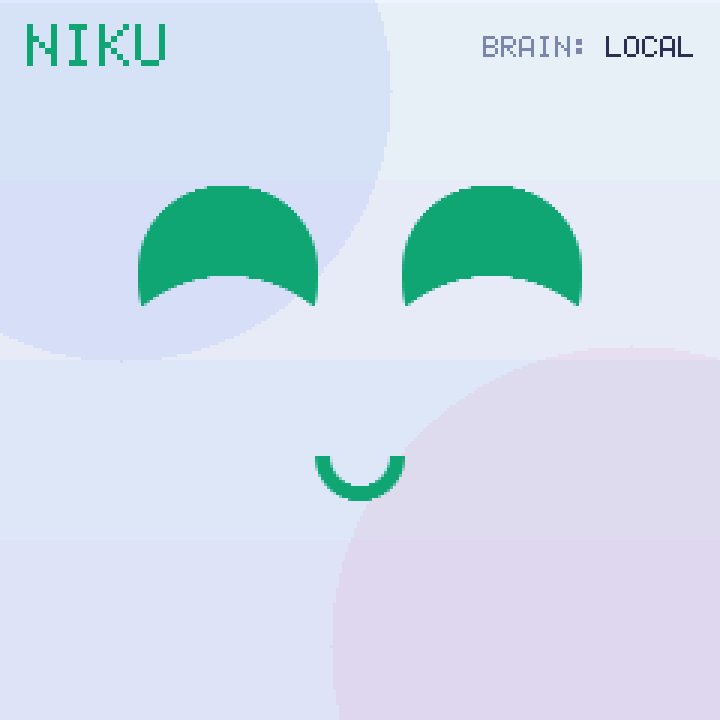 | 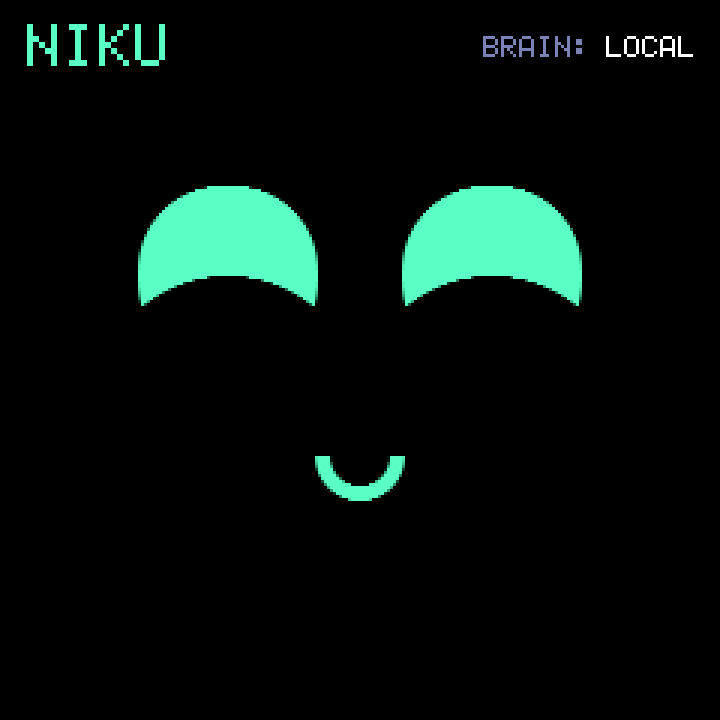 | 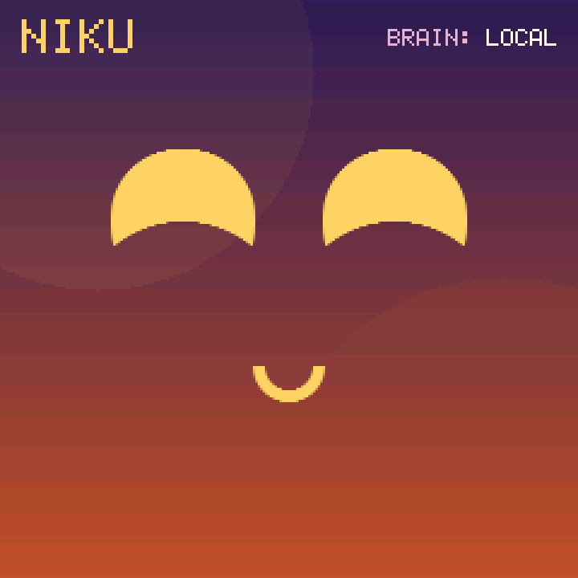 |
| --- | --- | --- | --- |

Between emotions the face tweens rather than cuts. It blinks every 2.5 to 5
seconds (one in six is a double), glances around every second or two, and
talks with its mouth while a line is revealed letter by letter. The top
corner says who is driving it: `BRAIN: LOCAL`, `PC` or `PHONE`.

## Its own moods

With no brain connected, the face follows the keyboard. Highest first:

| When | Face | Says |
| --- | --- | --- |
| A half drops out | sad | `WHERE DID LEFT GO?` - then `YAY, BACK!` when it returns |
| A half's battery is under 15 % | sleepy | `LOW BATTERY`, once |
| A brain is showing an emotion or saying a line | the brain's | the brain's |
| 20 seconds typing 30 % faster than your own average | happy | `NICE STREAK!`, at most every 10 minutes |
| Beating a WPM best that stood for two minutes | surprised | `NEW BEST!` |
| Five minutes without a key | sleepy, with Zs | - |
| Music playing (with a companion) | neutral, nodding along | - |
| After 23:00 (with a companion's clock) | slower blinks, a yawn now and then | `ITS LATE... BED?`, once a night |

Unprompted lines are at most one every three minutes; a half dropping out is
not chatter and is always said. A disconnect and a flat battery outrank even
a brain: the face never smiles over a keyboard that has stopped working.

## A brain

The dongle never runs AI. A brain is a program on the PC or the phone that
sends the host link's lines (`E` an emotion, `S` a line - see
[host-link.md](host-link.md#the-protocol)). Every line renews its hold on the
face for `CONFIG_NEXUS_BUDDY_LEASE_S`; quiet that long, or `B 0`, and the face
is Buddy's own again.

A brain has the face only while it is showing an emotion or saying a line.
Between those it may hold the lease - the PC companion renews it every ten
seconds - and Buddy still pokes, yawns, sulks and cheers a streak on its own.
A brain that leaves in the middle of a line gets a moment of sad face; one
that had finished and gone quiet just goes.

The face's clocks only run while it is on screen. Open it later and it
catches up quietly: a line said while it was away is not typed out again
(anything older than five seconds is dropped), and a lease that ran out
meanwhile has simply ended.

A line stays up for 2 seconds after it is fully shown, plus 0.15 s per
letter, so a long one can be read. Then the face goes back to neutral, even
though the brain still holds it. An emotion sent with no line, such as
THINKING while an answer is on its way, goes back after 30 seconds.

### The PC

Either companion, with `--buddy`:

```sh
python3 tools/nexus-host/nexus_host.py --buddy
```
```powershell
.\tools\nexus-host\nexus_host.ps1 -Buddy          # -Install -Buddy to start with Windows
```

It speaks when you sit down, every 10 minutes (`--buddy-minutes`, 5-60),
when a new song starts (at most every five minutes) and when the PC has been
flat out for a minute. It sends `B 1` every 10 seconds to keep the face, and
`B 0` before it quits.

**Gemini.** Put a key in `gemini.json` and the companion asks Gemini
(`gemini-3.1-flash-lite` by default). That file is all it takes: with a key
in it the companion is Buddy's brain without `--buddy`, and a running one
picks up a key pasted in within 30 seconds.

| | Where |
| --- | --- |
| Windows | `%LOCALAPPDATA%\NEXUS\gemini.json` - `-Install` writes an empty one |
| Linux, macOS | `~/.config/nexus/gemini.json` |

```json
{ "key": "<your key>", "model": "gemini-3.1-flash-lite" }
```

`model` is optional. The `GEMINI_API_KEY` environment variable works too and
wins over the file; `--gemini-model` / `-GeminiModel` wins over `model`. The
key is never an argument, which the process list would show, and never in a
repo - the file lives beside the installed companion, `.gitignore` covers
one dropped into the repo by mistake, and `-Uninstall` keeps it so a
reinstall needs nothing pasted again.

Get a key at
[Google AI Studio](https://aistudio.google.com/apikey); restrict it to the
Generative Language API and set a budget alert. A request goes out at most
every 20 seconds and typically every 10 minutes, well inside the free tier.
Out of quota, it rests - a minute, then longer each time - and says so once.

Without a key it says canned lines from `persona/persona.json`.

**Talking to it.** Double-click `tools/nexus-host/chat.cmd` (or run
`nexus_host.ps1 -Chat`) while the Windows companion is running, and type.
The full answer comes back in that window, and the dongle shows the face,
a short line and its sound. Buddy remembers the last six exchanges until
the companion restarts. A message is answered straight away, not held to
the gap between remarks; only Gemini's quota can make it wait. The
companion listens on `127.0.0.1` only, so nothing outside this PC can talk
to it. Chat needs a key: without one, or while out of quota, Buddy says so
instead of giving a canned line.

**Faces and tricks, instantly.** A message that only asks for a face
("show me a sad face", "smile", "be angry") or a trick ("high five", "sing a
song", "dance", "hands up", "bang", "thumbs up", "let's play a game",
"shoo", "good night", "wake up", "I love you", "good job") is acted out on
the spot, without Gemini and without a key. A trick is a few faces, lines
and glances about two seconds apart, using the six trick faces where one
fits. Anything
that says more ("why are you sad?", "sing about cats") still goes to Gemini.
The phrases are `commands` in `persona/persona.json`; add your own there.

**Voice.** Press Win+H in the chat window and talk: Windows' own voice
typing fills in the message. On the phone, hold the Buddy tab's microphone
button and speak, and letting go sends; or tap it, speak and tap again. The
dongle shows the listening face, then Gemini writes down what you said and
the app sends it like a typed message, so a spoken "show me a sad face" is
still instant. The clip is 16 kHz WAV and goes only to Gemini. Listening
stops by itself after 30 seconds, and closing the tab turns the mic off and
drops the clip.

### The phone

NEXUS Remote's Buddy tab (☺) is the same chat on the phone. Gemini answers
there, with a key you paste into the tab once. The key stays on the phone
and goes only to Google; Settings → Buddy removes it. When a message goes
out, the app sends `B 1`, the clock and `E THINKING` over the Companion
characteristic ([remote-input-protocol.md](remote-input-protocol.md)).
The answer's face and line follow, so the dongle shows them with the face's
sound, even with no PC companion running. From the phone only Buddy's lines
and the clock are taken, so the HOST screen still describes the PC. The
phone is a brain only while the app is open, because phones suspend a page
in the background.

### What a brain is told

Gemini hears the time of day, how busy the PC is as low / medium / high, the
track playing and why it is being asked - and in a chat, what you type to
it. Never keystrokes, window titles, screen contents or files. The dongle
sends nothing back at all.

Every answer is checked before the dongle sees it: an emotion it does not
have, a line over 24 characters or with characters the font cannot draw, or
JSON that does not parse, and a canned line goes instead.

## The persona

`persona/persona.json` is the one description of who Buddy is - name, owner,
traits, voice, a never-list, the canned lines and the face and trick
`commands` - and both companions and the app build Gemini's instructions
from it. The app keeps a copy in its `src/buddy/persona.json`; change both
together. The firmware takes its name from `CONFIG_NEXUS_BUDDY_NAME`.
`tests/buddy/test_buddy.py` fails if the default and the JSON disagree, if
their emotion lists do, if any command sends a line the dongle would refuse,
or if the app's copy differs (when the app is checked out beside this repo).

## Sound

A face's cue always plays whole: the per-letter blips wait for it, where
they used to cut it short. Every face has its own short cue inside the
buzzer's loud band, neutral's
a soft "mm-hm" that plays only when a brain sends it (settling back to
neutral on its own is not news). A brain's answer always follows its
THINKING face, so each one plays its face's cue. `CHATTY` adds a blip per
letter, pitched by the emotion. Buddy's sounds are the one soft
class: they only play into silence, and any other effect cuts them off, so
a chirp can never eat a disconnect cue. Buddy's own chatter waits while you
type - a cue waits for a pause, and gives up after 10 seconds. A brain's
answer does not wait: it arrives a second after you typed the question, and
a silent answer feels broken. That goes by whose sound it is, so a brain
that is only holding the lease does not let Buddy's own chirps through over
your typing. Nothing plays in quiet hours,
and nothing with the sound off in Settings. Buddy only makes sounds while its
face is on screen.

## Cost

Nothing at all unless `CONFIG_NEXUS_BUDDY=y`: every line of it is behind that
symbol, and CI builds the same images as before with it off. With it on, as
CI measured it on a nice!nano:

| | Flash | RAM |
| --- | --- | --- |
| The face and its moods (`nexus_dongle_buddy_local` over `nexus_dongle`) | +8,012 B | +384 B |
| With the PC and phone brains and the idle face (`nexus_dongle_buddy` over `nexus_dongle_host_all`) | +9,200 B | +768 B |

The second includes the phone's 256-byte line ring. Both were measured
before the six trick faces, which add roughly 2-3 KB of flash and no RAM.

Inside it: no heap, no thread, no float, no second frame buffer. The face
draws through the same 12-row band as everything else and repaints only the
rows that moved - a blink is the eyes' rows, a word the bubble's, and a face
at rest paints nothing. It animates at 20 frames a second with a computer on
USB, 10 on a charger or battery, and two while the display is blanked; it
is a NORMAL screen, not a game, so the display still blanks on its timeout.

## Limits

- The phone is a brain only while NEXUS Remote is open on screen.
- Voice is a recorded clip (tap or hold), not a live spoken conversation:
  it is written down when you finish, and Buddy answers in text. A local program can still
  drive the mouth with `V` while it plays its own speech.
- Buddy's sounds play only while its face is up; elsewhere it stays quiet.
- Typing speed is the only typing signal: the dongle never looks at which
  keys you press.
- Chat and the face commands are in the Windows companion and the app; the
  Linux and macOS companion is a brain for remarks only.
- With both the PC and the phone driving it, `BRAIN:` shows whichever spoke
  last, so it can flip between `PC` and `PHONE`.
