# Buddy

A small animated face on the dongle, with moods, short lines and chirps. It
blinks and glances around on its own, cheers a typing streak, sulks when a
half drops out and nods along to music. A brain on the PC or the phone can
drive it with an emotion and a line - from Gemini, or canned - and with no
brain at all it runs on moods of its own.

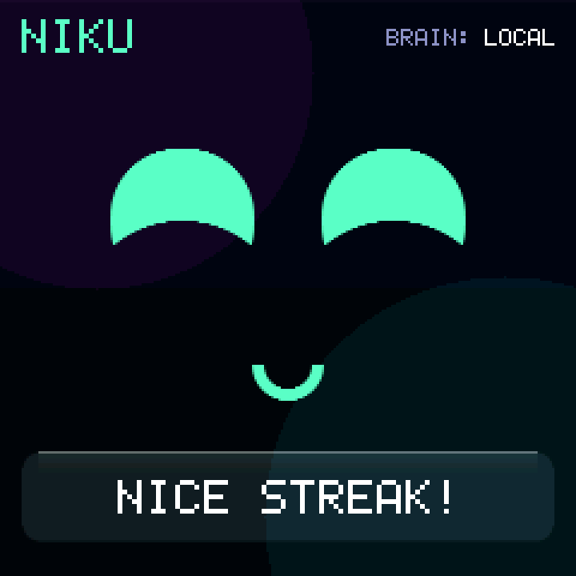

Off by default, and off adds nothing to the build.

## Turning it on

In your config's `nexus_dongle.conf`:

```
CONFIG_NEXUS_BUDDY=y
CONFIG_NEXUS_BUDDY_OWNER="VAIBHAV"
# Optional: Buddy asleep instead of a blank screen, with a computer on USB.
# CONFIG_NEXUS_BUDDY_IDLE_FACE=y
```

Then **Settings > BUDDY > SHOW**, or bind a key:

```c
&nexus_action NEXUS_ACT_BUDDY     /* opens the face; again closes it */
```

On the face, a **tap** pokes it (a giggle and a line) and a **hold** goes back.

| Option | Default | |
| --- | --- | --- |
| `CONFIG_NEXUS_BUDDY_NAME` | `"NIKU"` | The name above the face. |
| `CONFIG_NEXUS_BUDDY_OWNER` | `""` | Your name, for a greeting and the odd line. |
| `CONFIG_NEXUS_BUDDY_IDLE_FACE` | `n` | Sleep on screen instead of blanking, with a computer on USB. |
| `CONFIG_NEXUS_BUDDY_PHONE` | `y` | NEXUS Remote may be the brain. |
| `CONFIG_NEXUS_BUDDY_LEASE_S` | `60` | How long a silent brain keeps the face. |
| `CONFIG_NEXUS_BUDDY_QUIET_START` / `_END` | `23` / `8` | No sounds in these hours. |

[configuration.md](configuration.md#buddy) has the details.

## Settings > BUDDY

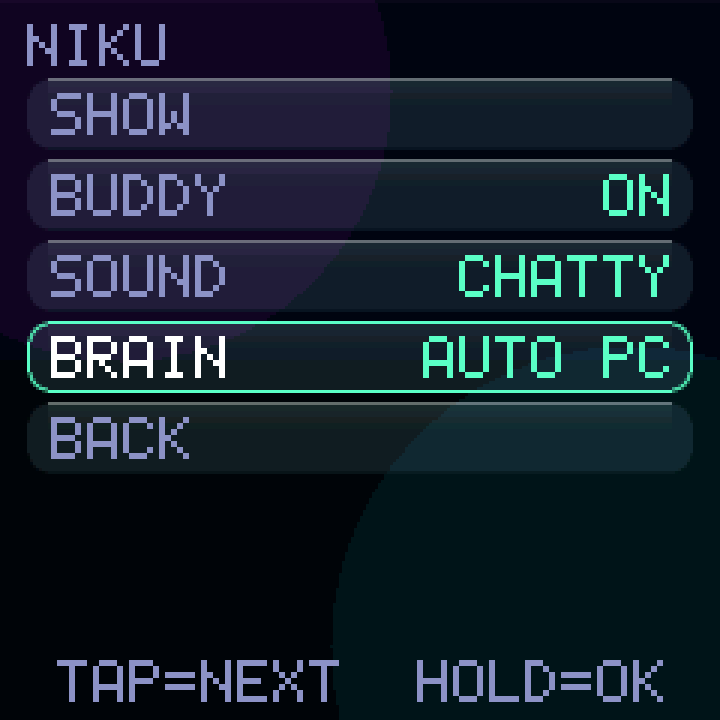

| Row | |
| --- | --- |
| `SHOW` | Open the face. |
| `BUDDY` | `ON`, or `OFF`: asleep, silent, ignoring every brain. |
| `SOUND` | `OFF`, `CHIRPS` (a cue per emotion, at most one unprompted every three minutes) or `CHATTY` (and a typing blip per letter as a line appears; the default). |
| `BRAIN` | Who may drive the face: `AUTO` (whoever spoke last - the row also shows who that is), `PC`, `PHONE`, or `LOCAL` (nobody; its own moods only). |

They are saved with SAVE like everything else, under their own key.

## The faces

Fifteen of them, each a row of numbers in `src/buddy/face_anim.c` and drawn
from geometry - no sprites. The last six hold a drawn prop for the tricks:
a microphone with notes, a waving hand, both hands up, a thumbs-up, a
gamepad, and a screen cracked from a hit. Every colour is a theme slot, so they read on
every palette, DAYLIGHT's light ground included. A slot too close to the
background (AMOLED and CLAY have no glow colour, which sad and listening
use) is drawn in the theme's text colour instead.

| | | |
| --- | --- | --- |
| 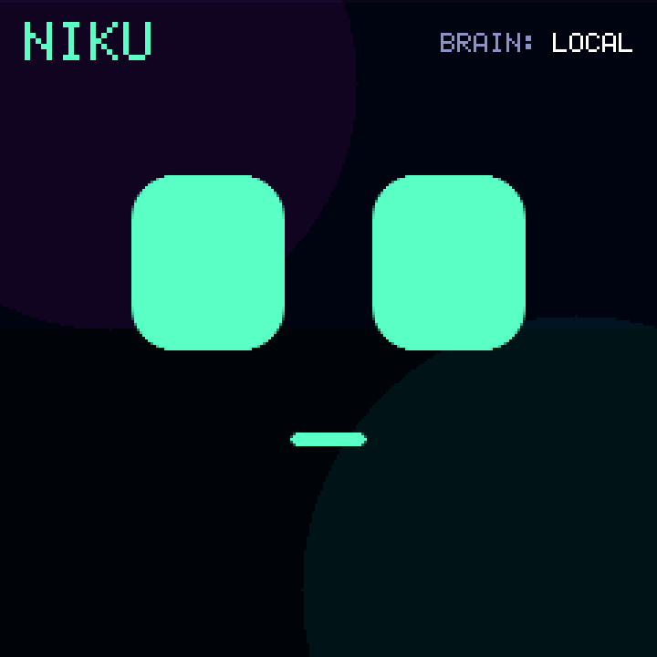 |  | 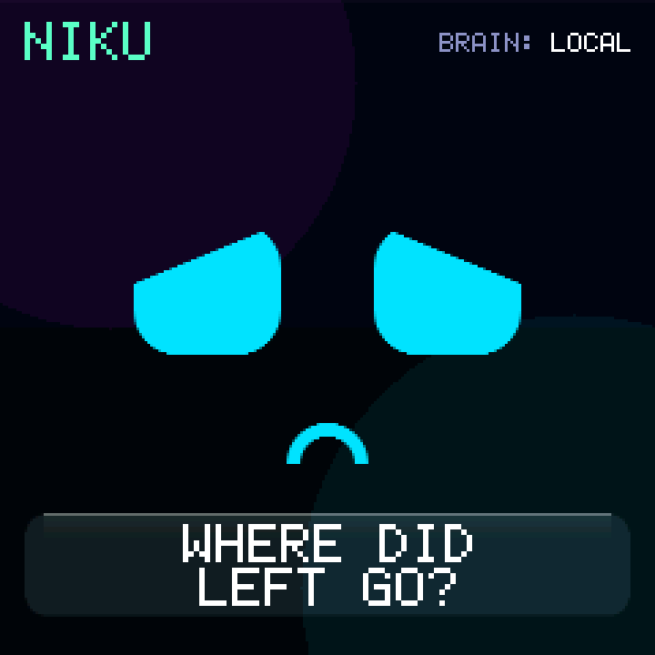 |
| neutral | happy | sad |
| 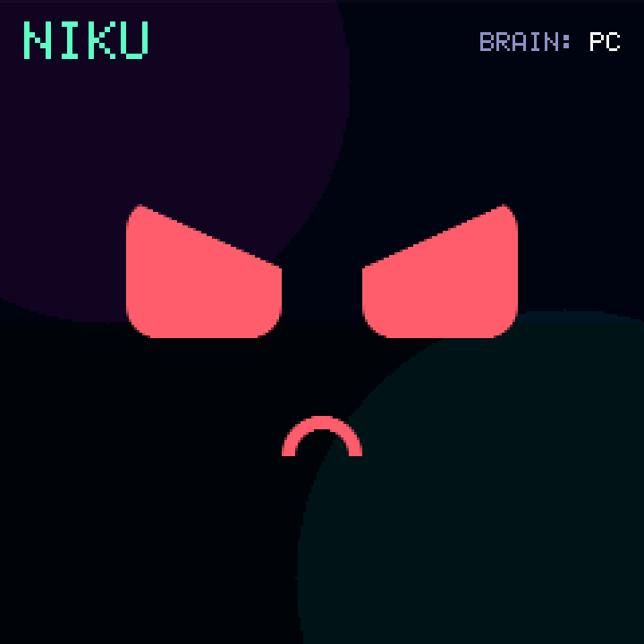 | 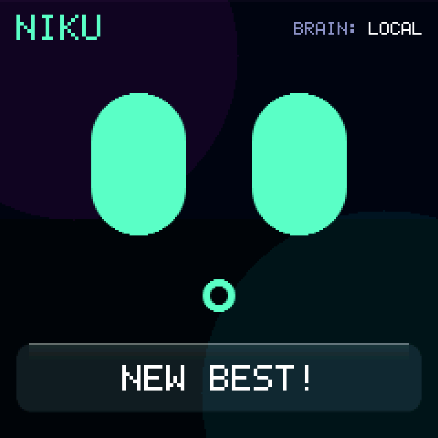 | 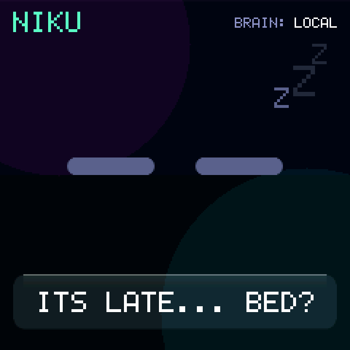 |
| angry | surprised | sleepy |
| 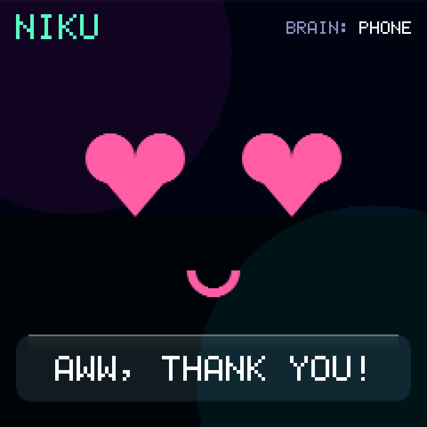 | 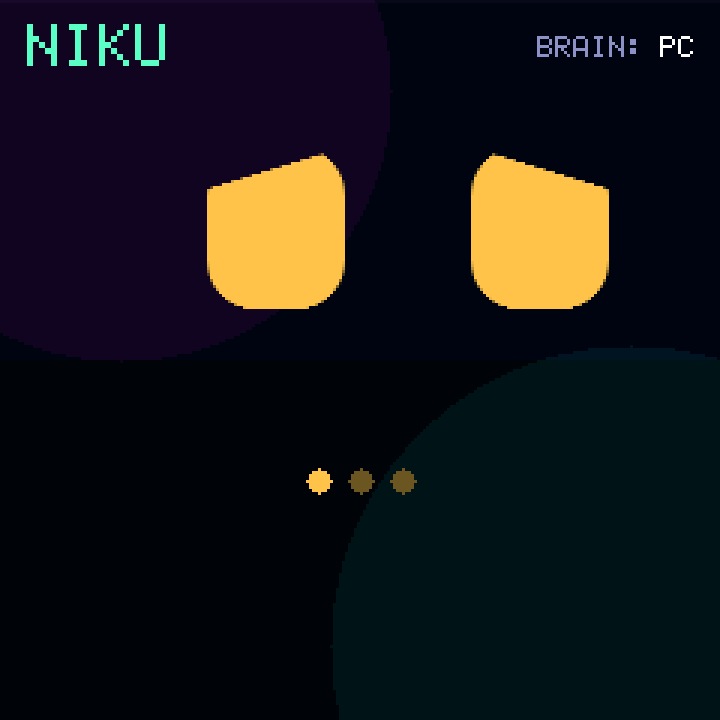 | 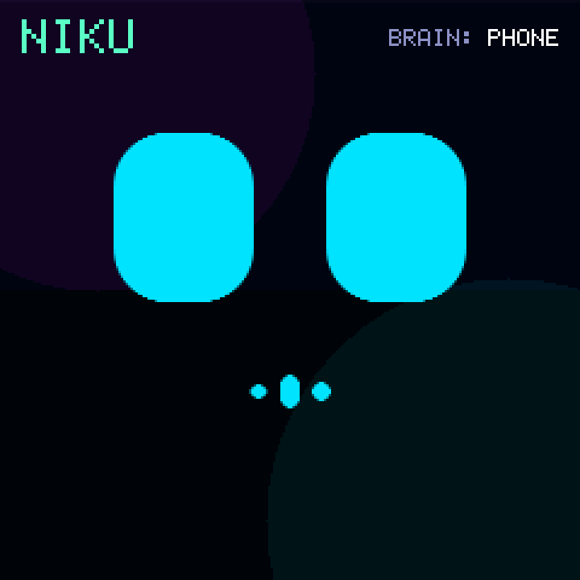 |
| love | thinking | listening |
| 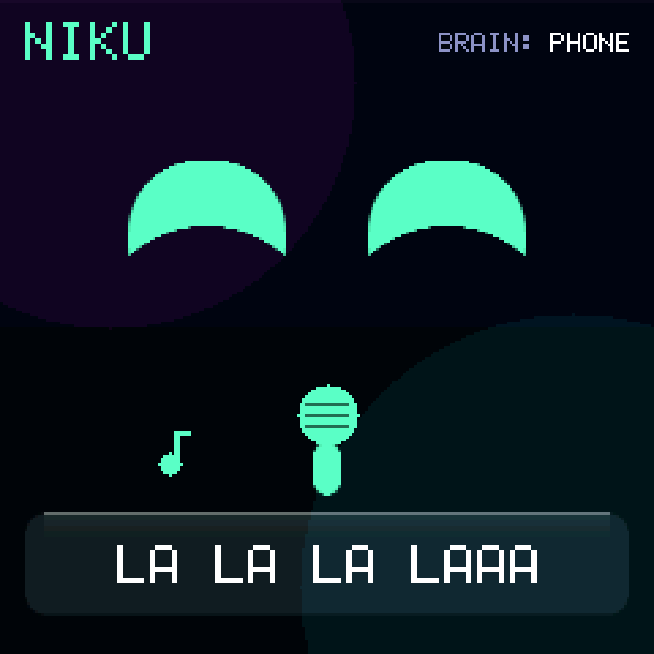 |  | 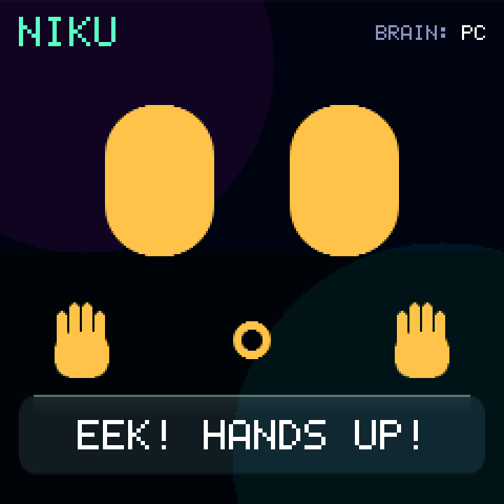 |
| singing | highfive | handsup |
| 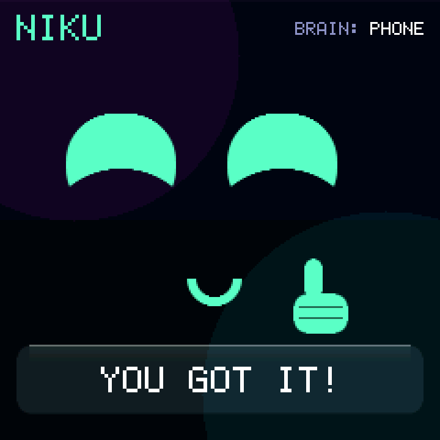 | 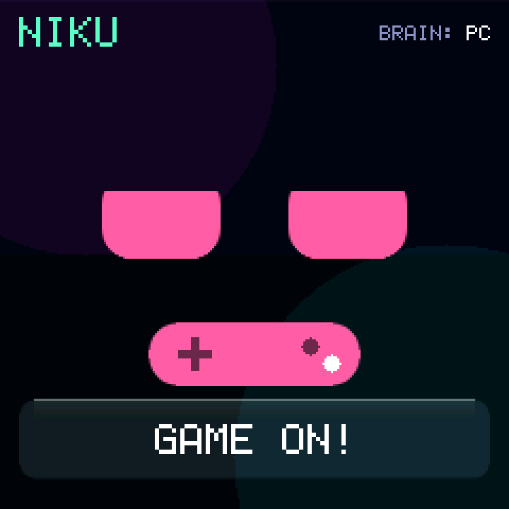 | 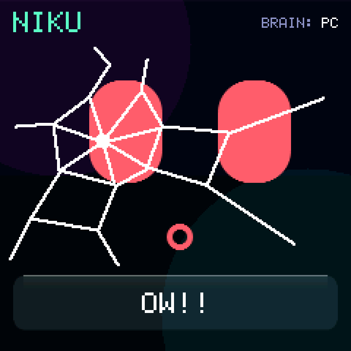 |
| thumbsup | gaming | bang |

| 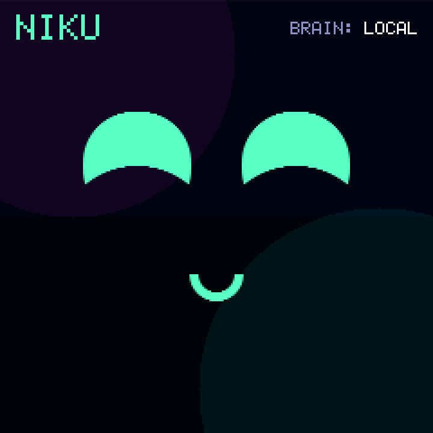 | 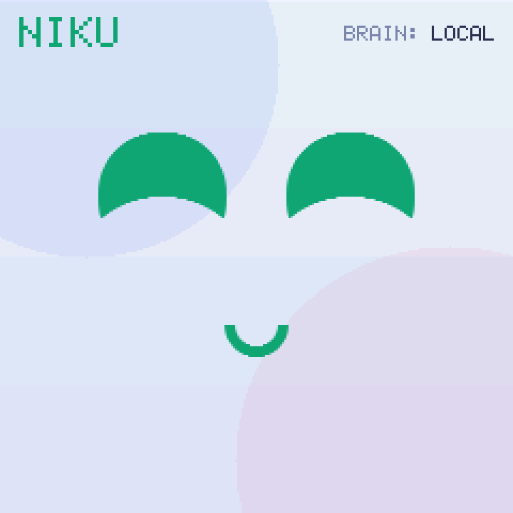 | 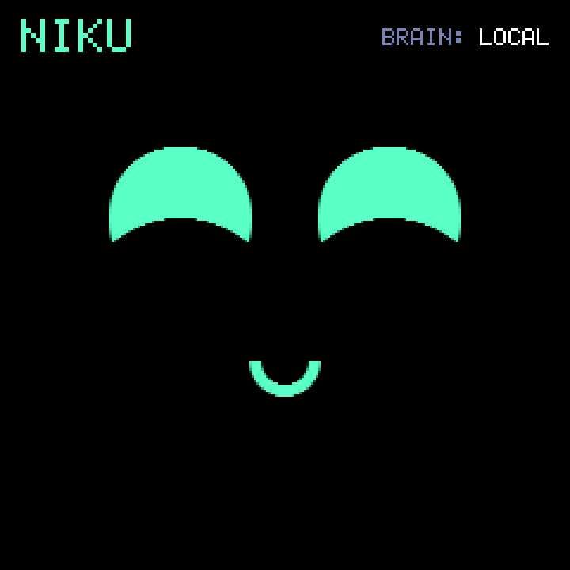 | 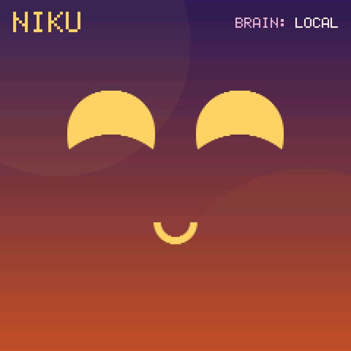 |
| --- | --- | --- | --- |

Between emotions the face tweens rather than cuts. It blinks every 2.5 to 5
seconds (one in six is a double), glances around every second or two, and
talks with its mouth while a line is revealed letter by letter. The top
corner says who is driving it: `BRAIN: LOCAL`, `PC` or `PHONE`.

## Its own moods

With no brain connected, the face follows the keyboard. Highest first:

| When | Face | Says |
| --- | --- | --- |
| A half drops out | sad | `WHERE DID LEFT GO?` - then `YAY, BACK!` when it returns |
| A half's battery is under 15 % | sleepy | `LOW BATTERY`, once |
| A brain is showing an emotion or saying a line | the brain's | the brain's |
| 20 seconds typing 30 % faster than your own average | happy | `NICE STREAK!`, at most every 10 minutes |
| Beating a WPM best that stood for two minutes | surprised | `NEW BEST!` |
| Five minutes without a key | sleepy, with Zs | - |
| Music playing (with a companion) | neutral, nodding along | - |
| After 23:00 (with a companion's clock) | slower blinks, a yawn now and then | `ITS LATE... BED?`, once a night |

Unprompted lines are at most one every three minutes; a half dropping out is
not chatter and is always said. A disconnect and a flat battery outrank even
a brain: the face never smiles over a keyboard that has stopped working.

## A brain

The dongle never runs AI. A brain is a program on the PC or the phone that
sends the host link's lines (`E` an emotion, `S` a line - see
[host-link.md](host-link.md#the-protocol)). Every line renews its hold on the
face for `CONFIG_NEXUS_BUDDY_LEASE_S`; quiet that long, or `B 0`, and the face
is Buddy's own again.

A brain has the face only while it is showing an emotion or saying a line.
Between those it may hold the lease - the PC companion renews it every ten
seconds - and Buddy still pokes, yawns, sulks and cheers a streak on its own.
A brain that leaves in the middle of a line gets a moment of sad face; one
that had finished and gone quiet just goes.

The face's clocks only run while it is on screen. Open it later and it
catches up quietly: a line said while it was away is not typed out again
(anything older than five seconds is dropped), and a lease that ran out
meanwhile has simply ended.

A line stays up for 2 seconds after it is fully shown, plus 0.15 s per
letter, so a long one can be read. Then the face goes back to neutral, even
though the brain still holds it. An emotion sent with no line, such as
THINKING while an answer is on its way, goes back after 30 seconds.

### The PC

Either companion, with `--buddy`:

```sh
python3 tools/nexus-host/nexus_host.py --buddy
```
```powershell
.\tools\nexus-host\nexus_host.ps1 -Buddy          # -Install -Buddy to start with Windows
```

It speaks when you sit down, every 10 minutes (`--buddy-minutes`, 5-60),
when a new song starts (at most every five minutes) and when the PC has been
flat out for a minute. It sends `B 1` every 10 seconds to keep the face, and
`B 0` before it quits.

**Gemini.** Put a key in `gemini.json` and the companion asks Gemini
(`gemini-3.1-flash-lite` by default). That file is all it takes: with a key
in it the companion is Buddy's brain without `--buddy`, and a running one
picks up a key pasted in within 30 seconds.

| | Where |
| --- | --- |
| Windows | `%LOCALAPPDATA%\NEXUS\gemini.json` - `-Install` writes an empty one |
| Linux, macOS | `~/.config/nexus/gemini.json` |

```json
{ "key": "<your key>", "model": "gemini-3.1-flash-lite" }
```

| Key | Default | |
| --- | --- | --- |
| `key` | - | Your Gemini API key. |
| `model` | `gemini-3.1-flash-lite` | What remarks and chat ask first. Busy, out of quota or gone, they go on to `gemini-3.5-flash-lite`, then `gemini-flash-lite-latest`. |
| `liveModel` | `gemini-3.8-live` | What `voice.cmd` talks to first (Windows); the rest of the chain follows it (see *When a model gives out*). |
| `voice` | `Achernar` | The voice Buddy speaks in, one of Gemini Live's prebuilt voices. Achernar is soft and calm; `Vindemiatrix`, `Sulafat`, `Despina` and `Aoede` are other gentle ones. |
| `headset` | `false` | `true` keeps the mic open while Buddy talks, so you can cut in. Only with a headset: speakers echo. |
| `city` | - | Where the weather is for, e.g. `"Pune"`. Without it, Windows' own location (Settings > Privacy > Location, on for desktop apps). |

Everything but `key` is optional. The `GEMINI_API_KEY` environment variable works too and
wins over the file; `--gemini-model` / `-GeminiModel` wins over `model`. The
key is never an argument, which the process list would show, and never in a
repo - the file lives beside the installed companion, `.gitignore` covers
one dropped into the repo by mistake, and `-Uninstall` keeps it so a
reinstall needs nothing pasted again.

Get a key at
[Google AI Studio](https://aistudio.google.com/apikey); restrict it to the
Generative Language API and set a budget alert. A request goes out at most
every 20 seconds and typically every 10 minutes, well inside the free tier.
Out of quota, it rests - a minute, then longer each time - and says so once.

Without a key it says canned lines from `persona/persona.json`.

**Talking to it.** Type in the voice window's message box (see *Talking out
loud* below) with the conversation ended, or double-click
`tools/nexus-host/chat.cmd` (`nexus_host.ps1 -Chat`) for the same in a
console, while the Windows companion is running.
The full answer comes back in that window, and the dongle shows the face,
a short line and its sound. Buddy remembers the last six exchanges until
the companion restarts. A message is answered straight away, not held to
the gap between remarks; only Gemini's quota can make it wait. The
companion listens on `127.0.0.1` only, so nothing outside this PC can talk
to it. Chat needs a key: without one, or while out of quota, Buddy says so
instead of giving a canned line. With the dongle unplugged or out of range,
Buddy still answers - the voice window's face shows it - but makes no remarks
of its own until the dongle is back. When Google says Gemini is busy, the
companion tries twice more before giving up.

**Faces and tricks, instantly.** A message that only asks for a face
("show me a sad face", "smile", "be angry") or a trick ("high five", "sing a
song", "dance", "hands up", "bang", "thumbs up", "let's play a game",
"shoo", "good night", "wake up", "I love you", "good job") is acted out on
the spot, without Gemini and without a key. A trick is a few faces, lines
and glances about two seconds apart, using the six trick faces where one
fits. Anything
that says more ("why are you sad?", "sing about cats") still goes to Gemini.
The phrases are `commands` in `persona/persona.json`; add your own there.
Said out loud in a voice conversation they work the same - "can you show me
an angry face?", "sing me a song", "bang!" - played by the companion while
Buddy answers in its own voice, and the face holds until the trick is done.

**Talking out loud.** Double-click `tools/nexus-host/voice.cmd` (or run
`nexus_host.ps1 -Voice`). A small window pops up in the bottom-right corner
and starts listening at once: talk through this PC's microphone, and Buddy
answers in a real voice through the speakers, using Gemini Live
(`liveModel`, `gemini-3.8-live` by default). On the dongle the face shows
LISTENING while you speak, then follows the feeling in Buddy's words as it
answers - a laugh or a "yay" is happy, "oh no" or "sorry" sad, "hmm" thinking -
and the mouth moves with the speech and closes when it stops.

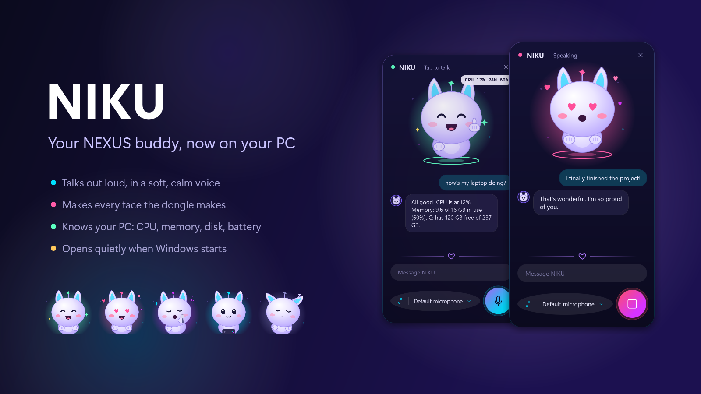

The window has Buddy as a little creature that makes every face the dongle
makes - all fifteen, from the same names - and moves its mouth with the
voice. It blinks, its glow and the ring under it take the mood's colour, and
the dongle's short line appears beside it, typed out the same way. It shows
whatever the dongle is showing: the companion copies each of Buddy's lines
(an emotion, a line, a glance) to the window on `127.0.0.1:47803`, so a
remark, a trick ("high five", "sing") or a chat answer plays on both.

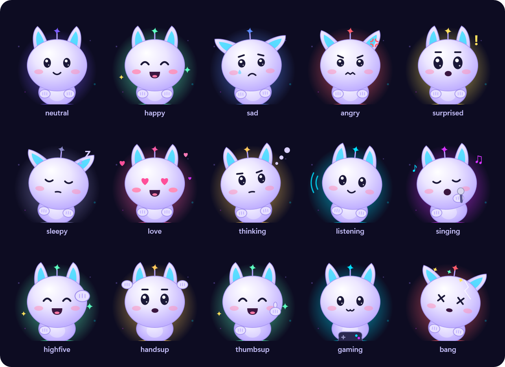

| Listening | Talking | A typed chat |
| --- | --- | --- |
| 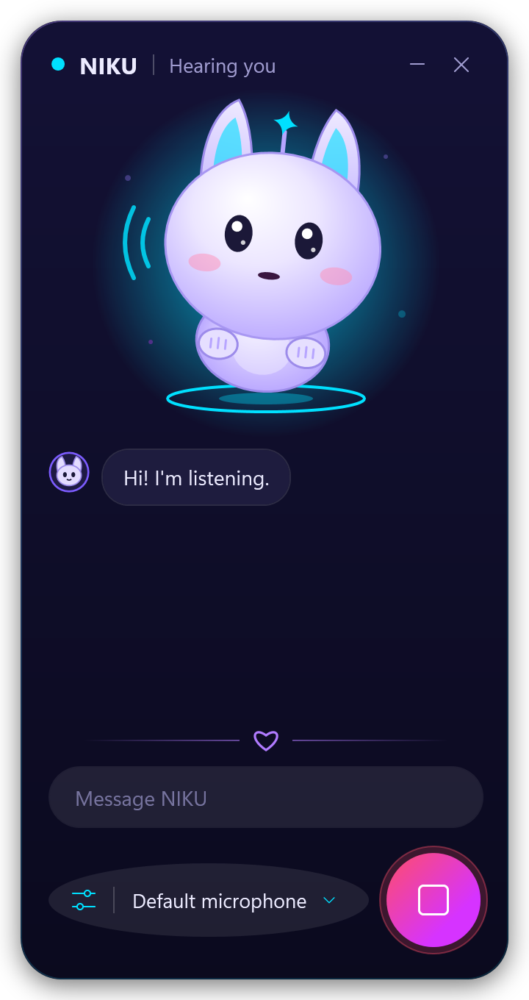 | 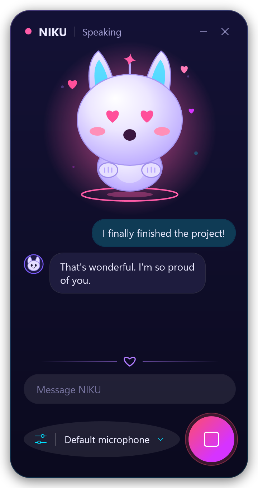 | 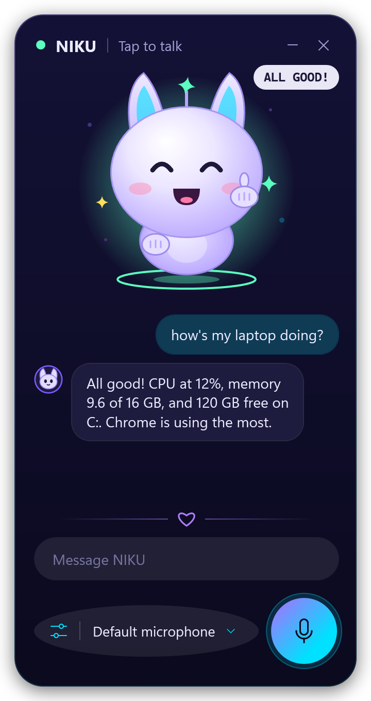 |

Below the creature: what each of you said, a message box, and the buttons.
The round button ends the conversation and starts a new one. The pill beside
it opens the settings: the microphone, which the window remembers by name in
`%LOCALAPPDATA%\NEXUS\voice.json`, and whether the window opens when Windows
starts. Drag the window by its top edge. Closing it ends the conversation with
the mouth shut; Esc clears a half-typed message, and closes the window when
there is none. Double-clicking `voice.cmd` again brings the open window
forward rather than opening a second.

**At sign-in.** `install.cmd` sets the window to open when Windows starts -
quietly (`-Idle`): it pops up, but the microphone stays off until you tap the
button. Switch it off in the window's settings, or under Task Manager ->
Startup apps (`NEXUS Buddy`); `uninstall.cmd` removes it and closes the
window.

**From the keyboard.** While the window is open, **Ctrl+Alt+Shift+N** starts
a conversation from anywhere in Windows, and ends it again, like the Talk
button. A minimised window comes back up; the app you are typing in keeps
the focus. A key on the keyboard can send it - in your config's keymap:

```c
&kp LC(LA(LS(N)))     /* Buddy: talk / stop */
```

It is not Ctrl+Alt+N because a hotkey wins over every app, and that one is
VS Code's *Run Code*. If another app already has the combination, the window
says so and the button still works.

**Dictate anywhere - hold /.** Hold the key, talk, let go: what you said is
typed where your caret is, in any app - cleaned up by Flash Lite: fillers and
repeats gone, punctuation and capitals in, "new line", "new paragraph" and
"bullet point" made real. Start with an instruction and it is followed, not
typed: "make it formal ...", "translate to Hindi ...", "shorter ...". About
two seconds after you let go (gemini-3.1-flash-lite first: measured
1.7-2.8 s, where 3.5 Flash Lite took 6-7). The window notes what it typed.

**"What's this?" - hold Z.** Select something in any app - an error, a
paragraph, code, a sentence in another language - hold the key and ask, or
say nothing; let go: Buddy answers out loud, in a conversation it starts if
none is going, so you can follow up by voice ("how do I fix it?", "shorter").
"Paste that", "replace it with a politer one" types the answer over your
selection (`paste_text`, refused unless you asked). With nothing selected it
looks at the screen instead, and shows you what it saw.

Both hold their keys as Ctrl+Alt+Shift+D (/) and Ctrl+Alt+Shift+E (Z), so
your config's keymap sends those on hold:

```c
&buddy_ht LC(LA(LS(E))) Z      /* hold: what's this? */
&buddy_ht LC(LA(LS(D))) FSLH   /* hold: dictate */
```

The text is pasted, then your clipboard put back (text only: a picture on
the clipboard is replaced). A conversation going on does not hear what you
say while a key is held. Nothing is recorded until a key is held, and the
clip goes only to Gemini.

**Asking about this PC.** Type "how's my laptop doing?", "what's using my
memory?", "how much battery is left?", "disk space" or "what are my specs?" -
in the window or `chat.cmd` - and the PC answers it itself, at once, from its
own numbers: CPU load, memory used and the three apps using the most of it,
free space on the system disk, battery and charging, uptime, and the Windows
version and processor. Like a face or a trick, it never goes to Gemini, and
works with no key and no internet. Everyday uses of the same words - "I have
a bad memory", "my social battery is low" - are still chat, for Gemini. The dongle and the window show a
thumbs-up and a short line (`CPU 12% RAM 60%`, `BATTERY 100%`), or a look
when something needs one: a busy PC, a nearly full disk, a low battery.

Asked out loud, in a voice conversation, the answer has to come back in
Buddy's voice, which Gemini makes: there Gemini calls a `get_pc_stats` tool
and gets the same numbers, for that answer only.

**Things Buddy does on this PC.** In a voice conversation Gemini can ask the
PC to do a few things, each run here and costing no quota beyond the ask:

| Say | What happens |
| --- | --- |
| "What's the weather?", "will it rain tomorrow?" | The weather now, today and tomorrow, from [Open-Meteo](https://open-meteo.com) - free, no key - for `city` in `gemini.json` or Windows' location. Typed to chat it is answered the same way, without Gemini. |
| "Pause the music", "next song", "turn it up" | A media key, as the keyboard's own would send: play/pause, next, previous, volume (2 % a press; "up" is five), mute. |
| "Remind me in 20 minutes to stretch", "remind me at 5:30 pm to call mom", "start a pomodoro" | A timer in the window - said in a conversation, or typed with none going ("set a timer for 5 min"). When it ends the window chimes and says so, the dongle looks surprised, and Buddy says it - in a conversation in its own voice, else in the Windows voice. Up to ten; "cancel my timers" stops them. They live in the window (which opens at sign-in), so closing it drops them. |
| "Remember my exam is on Friday", "forget about the exam" | A fact kept in `%LOCALAPPDATA%\NEXUS\memory.json` - this PC only, dated, the last 60 - and put into every conversation's prompt, typed chat included, so Buddy knows it tomorrow. Said or typed, in a conversation or not, it is kept, and the window notes "Remembered: ...". Delete the file to forget everything, or say "forget everything". |
| "Look at my screen - what does this error say?", "what am I holding?" | One picture of the screen your mouse is on (in real pixels, whatever the scaling), or one photo from the camera (its light comes on), sent to Gemini to answer from - and shown in the chat, so you see exactly what Buddy saw. Only when you have just asked it to look: the window refuses a look Gemini asks for by itself. |

**The camera.** The settings list every camera, like the microphones; the one you pick is remembered by name. Virtual cameras (Camo, OBS) and IR face-unlock cameras go last, a webcam's black first frames are waited out, and a camera that stays black - a laptop with its lid shut, a closed shutter - is skipped for the next, with a note. **Live camera view**, in the settings or by saying "turn on the camera": a card above the chat - Buddy drawn a little smaller to make room - with a LIVE tag, and while you talk Gemini sees a frame every 3 seconds (about 200 tokens each), so you can show it things and talk about them. It goes off by itself when the PC locks or sleeps, or after two minutes with no conversation; "camera off" stops it sooner.

Remembered facts are also how Buddy learns things it sees: "this blue mug is
mine - remember it" keeps the description, and the next look can match it.

And once a day, in the first conversation, Buddy speaks first: a short
greeting. These need a Live model; Flash Lite, the last step of the chain,
only talks.

**Typing in the window.** The message box above the buttons goes where the
conversation is:

| | A typed message |
| --- | --- |
| Talking (red button) | Joins the spoken conversation. Buddy answers it out loud, with the same memory of what was said. |
| Ended (cyan button) | Goes to the companion's chat, the same as `chat.cmd`: a written answer, the face and a short line on the dongle, and faces and tricks ("high five", "sing") played at once. |

So for a quiet chat, end the conversation and type. A message typed while it
is still connecting is sent once it is ready.

The compiled audio and window code is kept as
`%LOCALAPPDATA%\NEXUS\voice-<hash>.dll`, so later starts skip compiling; a new
version of the script builds a new one. If something stops the window opening,
a message box says what; run `nexus_host.ps1 -Voice` from a PowerShell prompt
to see more.

The pictures above are the window's own renders. After changing it, redraw
them with:

```powershell
powershell -STA -File tools\nexus-host\nexus_host.ps1 -Voice -Shot docs\images\voice
```

The face and mouth go through the companion, which already holds the dongle's
port: `voice.cmd` sends them to it on `127.0.0.1:47802`, and the companion
passes on only emotions and mouth positions, over USB or Bluetooth, whichever
it has. The face must be open on the dongle (Settings > BUDDY > SHOW, or the
Buddy key). So the companion must be running,
and installed from this version: **run `install.cmd` again** after updating,
or the copy in `%LOCALAPPDATA%\NEXUS` will not have the part that listens.
While a voice conversation is going, and for 30 seconds after, Buddy keeps
its own remarks to itself. The microphone audio goes only to Google, over the
same key, and the key goes in a request header, never the URL.

Speakers echo into a microphone, and Buddy would hear itself and stop
mid-sentence. So the mic sends silence while Buddy talks and for a moment
after, and you cannot cut in. With a headset there is no echo: set
`"headset": true` in `gemini.json` and you can interrupt Buddy mid-sentence.

**When a model gives out.** A conversation does not stop when its model is
out of quota, busy or gone: it carries on down a chain, says so in a note,
and keeps what was said. Each Live model has a quota of its own.

| | Model | First word after you stop (measured) |
| --- | --- | --- |
| 1 | `liveModel`, `gemini-3.8-live` by default | about 0.5 s |
| 2 | `gemini-3.1-flash-live-preview` | 0.6 - 1 s |
| 3 | `gemini-2.5-flash-native-audio-preview-12-2025` | about 2 s |
| 4 | Flash Lite: `gemini-3.5-flash-lite`, `gemini-flash-lite-latest`, `gemini-3.1-flash-lite` | about 3.5 s, in the Windows voice |

A model out of quota rests for ten minutes, a busy one for two; the next
conversation starts from the top again. The last step needs no Live at all:
the window hears a whole sentence itself (it ends at a pause), sends it to
Flash Lite, which writes down what you said and answers, and Windows' own
voice says it - with the same mouth on the dongle. There you cannot cut in,
and the voice is Windows' rather than Gemini's; Flash Lite tries its three
models on every sentence, so it gives up only when all three are busy.

Google also closes every Live connection after a while (about ten to fifteen
minutes). The window reconnects in the next pause, by itself: `gemini-3.8-live`
picks the very conversation back up, any other model is told what was said.
And a long conversation costs no more each turn than a short one - Gemini
trims the oldest of it - since the limit that runs out is tokens a minute.

A conversation also ends by itself, with the mic off and a note saying why,
when nobody is at it: the PC is locked or goes to sleep, nobody has said
anything for two minutes, or the microphone is unplugged. Tap Talk to start
again.

**Voice typing.** Press Win+H in the chat window and talk: Windows' own voice
typing fills in the message. On the phone, hold the Buddy tab's microphone
button and speak, and letting go sends; or tap it, speak and tap again. The
dongle shows the listening face, then Gemini writes down what you said and
the app sends it like a typed message, so a spoken "show me a sad face" is
still instant. The clip is 16 kHz WAV and goes only to Gemini. Listening
stops by itself after 30 seconds, and closing the tab turns the mic off and
drops the clip.

### The phone

NEXUS Remote's Buddy tab (☺) is the same chat on the phone. Gemini answers
there, with a key you paste into the tab once. The key stays on the phone
and goes only to Google; Settings → Buddy removes it. When a message goes
out, the app sends `B 1`, the clock and `E THINKING` over the Companion
characteristic ([remote-input-protocol.md](remote-input-protocol.md)).
The answer's face and line follow, so the dongle shows them with the face's
sound, even with no PC companion running. From the phone only Buddy's lines
and the clock are taken, so the HOST screen still describes the PC. The
phone is a brain only while the app is open, because phones suspend a page
in the background.

### What a brain is told

Gemini hears the time of day, how busy the PC is as low / medium / high, the
track playing and why it is being asked - and in a chat, what you type to
it. A typed question about the PC is answered on the PC and never sent; a
spoken one, in a voice conversation, sends its numbers for that answer
(above): load, memory, disk, battery, uptime, Windows version and the names
of the three apps using the most memory. What you asked Buddy to remember
goes into its prompt; a picture of the screen or camera goes only when you
ask it to look, and the window notes each one. The weather asks Open-Meteo
for your city or location, and nothing else. Never keystrokes, window titles
or files, and the screen only in a picture you asked for. The dongle sends
nothing back at all.

Every answer is checked before the dongle sees it: an emotion it does not
have, a line over 24 characters or with characters the font cannot draw, or
JSON that does not parse, and a canned line goes instead.

## The persona

`persona/persona.json` is the one description of who Buddy is - name, owner,
traits, voice, a never-list, the canned lines and the face and trick
`commands` - and both companions and the app build Gemini's instructions
from it. The app keeps a copy in its `src/buddy/persona.json`; change both
together. The firmware takes its name from `CONFIG_NEXUS_BUDDY_NAME`.
`tests/buddy/test_buddy.py` fails if the default and the JSON disagree, if
their emotion lists do, if any command sends a line the dongle would refuse,
or if the app's copy differs (when the app is checked out beside this repo).

## Sound

A face's cue always plays whole: the per-letter blips wait for it, where
they used to cut it short. Every face has its own short cue inside the
buzzer's loud band, neutral's
a soft "mm-hm" that plays only when a brain sends it (settling back to
neutral on its own is not news). A brain's answer always follows its
THINKING face, so each one plays its face's cue. `CHATTY` adds a blip per
letter, pitched by the emotion. Buddy's sounds are the one soft
class: they only play into silence, and any other effect cuts them off, so
a chirp can never eat a disconnect cue. Buddy's own chatter waits while you
type - a cue waits for a pause, and gives up after 10 seconds. A brain's
answer does not wait: it arrives a second after you typed the question, and
a silent answer feels broken. That goes by whose sound it is, so a brain
that is only holding the lease does not let Buddy's own chirps through over
your typing. Nothing plays in quiet hours,
and nothing with the sound off in Settings. Buddy only makes sounds while its
face is on screen.

## Cost

Nothing at all unless `CONFIG_NEXUS_BUDDY=y`: every line of it is behind that
symbol, and CI builds the same images as before with it off. With it on, as
CI measured it on a nice!nano:

| | Flash | RAM |
| --- | --- | --- |
| The face and its moods (`nexus_dongle_buddy_local` over `nexus_dongle`) | +8,012 B | +384 B |
| With the PC and phone brains and the idle face (`nexus_dongle_buddy` over `nexus_dongle_host_all`) | +9,200 B | +768 B |

The second includes the phone's 256-byte line ring. Both were measured
before the six trick faces, which add roughly 2-3 KB of flash and no RAM.

Inside it: no heap, no thread, no float, no second frame buffer. The face
draws through the same 12-row band as everything else and repaints only the
rows that moved - a blink is the eyes' rows, a word the bubble's, and a face
at rest paints nothing. It animates at 20 frames a second with a computer on
USB, 10 on a charger or battery, and two while the display is blanked; it
is a NORMAL screen, not a game, so the display still blanks on its timeout.

## Limits

- The phone is a brain only while NEXUS Remote is open on screen.
- Talking out loud is Windows only (`voice.cmd`). On the phone, voice is a
  recorded clip (tap or hold) that is written down when you finish, and
  Buddy answers in text.
- With `voice.cmd` over Bluetooth, the mouth is a little less smooth than
  over USB: its lines wait for the companion's Bluetooth writes.
- With speakers, `voice.cmd` is half duplex: you cannot cut in while Buddy
  talks. A headset is not detected, so `"headset": true` has to be set by hand.
- Keep `voice.cmd`'s window open for as long as you talk.
- No Google Search in a voice conversation: with it, the free tier refuses
  `gemini-3.8-live` and `gemini-3.1-flash-live-preview` outright.
- The face reads Buddy's words, so a reply with no feeling in them stays
  neutral; the face changes at most every 2.5 s, each change a chirp.
- Buddy's sounds play only while its face is up; elsewhere it stays quiet.
- Typing speed is the only typing signal: the dongle never looks at which
  keys you press.
- Chat and the face commands are in the Windows companion and the app; the
  Linux and macOS companion is a brain for remarks only.
- With both the PC and the phone driving it, `BRAIN:` shows whichever spoke
  last, so it can flip between `PC` and `PHONE`.
